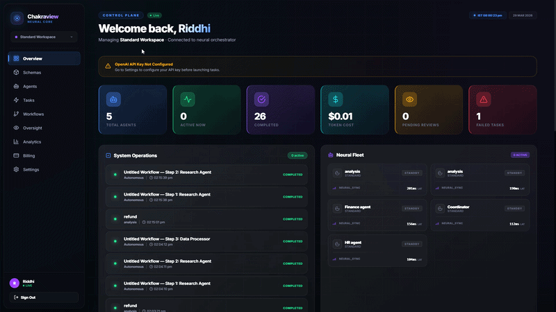
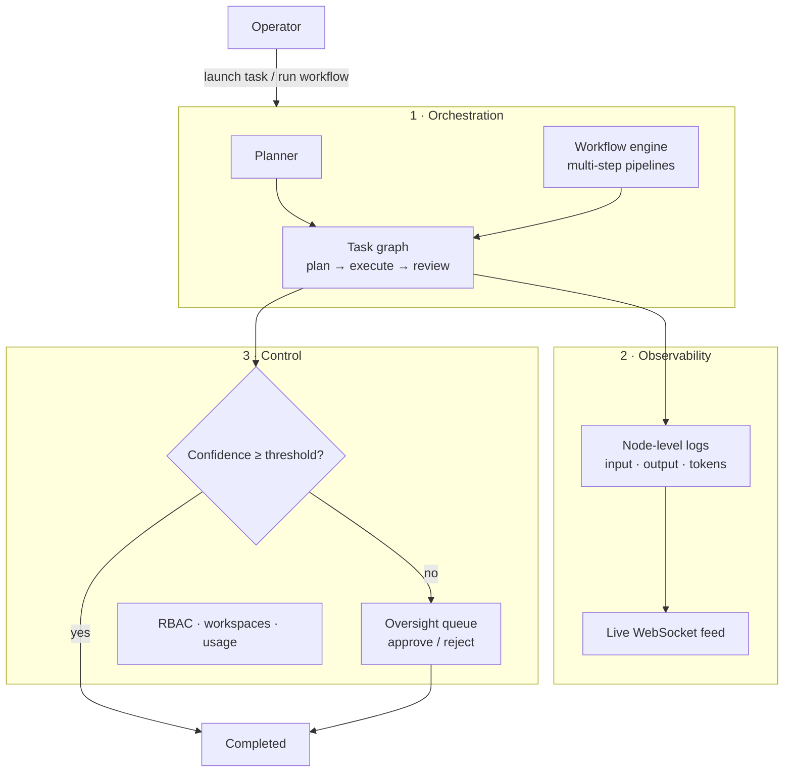

<div align="center">

# ⚡ Chakraview: AI Agent Command Center

**Launch many AI agents at once, watch every step they take, and step in when they are unsure.**

Chakraview is a control plane for multi-agent work. Agents run tasks and workflows in parallel, every decision is logged as a node you can inspect, and any low-confidence result waits for a human before it counts.

[](https://multi-layer-orchestation.vercel.app/)
[](https://nextjs.org/)
[](https://fastify.dev/)
[](https://sql.js.org/)
[](#realtime)
[](https://platform.openai.com/)



[Live demo](https://multi-layer-orchestation.vercel.app/) · [Why](#why) · [The three layers](#the-three-layers) · [Quick start](#quick-start) · [API](#api)

</div>

---

## Why

Single prompts became multi-step agent workflows, but the tooling around them did not keep up:

- When five agents run at once, nobody can see what each one is doing.
- When an agent is wrong, there is no record of *why* it decided what it did.
- When an agent is unsure, its output usually ships anyway.
- Nobody knows what the team is spending on tokens.

Chakraview is the layer that sits **above** the agents and handles orchestration, observability and control.

## The three layers



1. **Orchestration.** A task goes through planner, model-execution and result-review nodes. Workflows chain several steps, and tasks run in parallel with priorities.
2. **Observability.** Every node records its input, output and token use. Updates stream to the dashboard over WebSockets, so the task graph moves while you watch.
3. **Control.** Each result gets a confidence score. Below `OVERSIGHT_CONFIDENCE_THRESHOLD` (0.7 by default) the task stops at `waiting_for_approval` and lands in the **oversight queue** for an operator to approve or reject.

## Features

| | |
|---|---|
| 🤖 **Agent fleet** | Create agents with their own system prompt, model, capabilities, temperature and token limits |
| 🧩 **Workflow builder** | Build multi-step pipelines and run them on demand |
| 🕸️ **Live task graph** | Planner → execution → review nodes update in real time |
| 🛑 **Human oversight** | Low-confidence results wait in an approval queue |
| 🏢 **Multi-tenant** | Workspace isolation, with roles from owner and admin down to operator and viewer |
| 📊 **Analytics and billing** | Token use per workspace, usage dashboard and plan status |
| ✨ **AI input assist** | Suggests a well-formed task input from a rough idea |
| 🔑 **Bring your own key** | The OpenAI key is set per workspace in Settings |

## Tech stack

| Layer | Technology |
|---|---|
| Frontend | Next.js 14 (App Router), React 18 |
| Backend | Node.js, Fastify, `@fastify/jwt`, `@fastify/websocket`, `@fastify/cors` |
| Storage | SQLite through sql.js, persisted to `data/agents.db` |
| AI | OpenAI API |
| Auth | JWT and bcrypt |

## Quick start

**Prerequisites:** Node.js 18+, an OpenAI API key.

```bash
git clone https://github.com/kartikeyajay2006/multi-layer_orchestation.git
cd multi-layer_orchestation
npm run install:all
```

Create `backend/.env`:

```env
PORT=3001
JWT_SECRET=change-me
OVERSIGHT_CONFIDENCE_THRESHOLD=0.7
```

Create `frontend/.env`:

```env
NEXT_PUBLIC_API_URL=http://localhost:3001
NEXT_PUBLIC_WS_URL=ws://localhost:3001/ws
```

Then run the API and the dashboard together:

```bash
npm run dev      # API on :3001, dashboard on :3000
```

Sign up, add your OpenAI key under **Settings**, create an agent and launch a task.

## API

| Area | Endpoints |
|---|---|
| Auth | `POST /api/auth/signup` · `/login` · `/logout` · `GET /api/auth/me` |
| Agents | `GET POST /api/agents` · `GET PUT DELETE /api/agents/:id` |
| Tasks | `POST /api/tasks/launch` · `GET /api/tasks` · `GET /api/tasks/:id` · `/logs` · `/nodes` · `POST /api/tasks/:id/cancel` |
| Workflows | `GET POST /api/workflows` · `GET PUT DELETE /api/workflows/:id` · `POST /api/workflows/:id/execute` |
| Oversight | `GET /api/oversight/queue` · `POST /api/oversight/:id/approve` · `/reject` |
| Admin | `GET /api/admin/summary` · `/activity` · `/workspace-members` · `POST /api/admin/update-user` |
| Billing | `GET /api/billing/status` · `/usage` · `POST /api/billing/checkout` |
| Other | `GET /api/dashboard/stats` · `GET PUT /api/settings` · `POST /api/ai/suggest-input` · `GET /api/health` |
| Realtime | `GET /ws` (WebSocket) |

## Project structure

```text
backend/src/
  index.js              Fastify server, auth, CORS, WebSocket gateway
  routes/               auth, agents, tasks, workflows, oversight, admin, billing, settings, ai
  services/
    orchestrator.js     launch, cancel, run workflows
    agentRunner.js      plan → execute → review nodes, confidence, oversight
    openai.js           per-workspace client, planning, result analysis
    websocket.js        broadcast to dashboards
frontend/
  app/                  dashboard, agents, tasks, workflows, oversight, analytics, admin, billing
  components/           TaskGraph, WorkflowBuilder, AgentFleet, TaskQueue, MetricCards
```

## Roadmap

- PostgreSQL storage and a Redis job queue for horizontal scale
- Replay a past task with a different model or prompt
- Tool-call guardrails with allowlists per agent
- Cost budgets that pause a workspace before it overspends

## Author

Built by **[Kartikeya Yadav](https://github.com/kartikeyajay2006)**.
[LinkedIn](https://www.linkedin.com/in/kartikeya2006/) · [Portfolio](https://kartikeya-portfolio-rx7w.vercel.app/)
